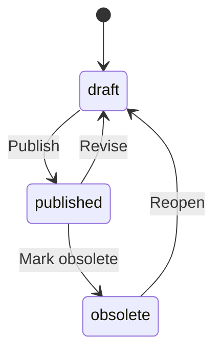
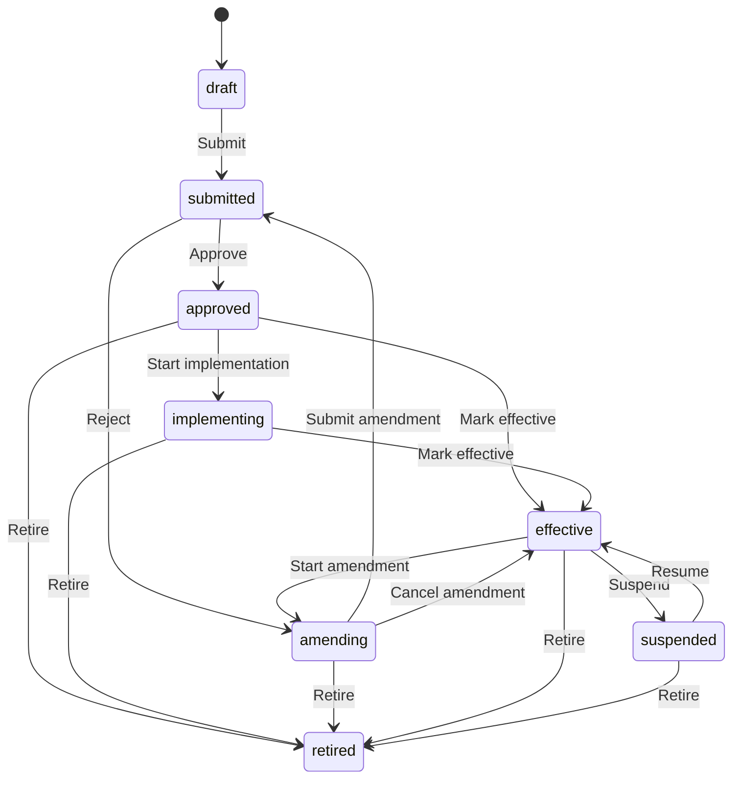

# iTop ISMS Extension

Copyright (c) 2024-2026 Björn Rudner
[](https://github.com/rudnerbjoern/iTop-br-isms/issues)
[](https://github.com/rudnerbjoern/iTop-br-isms/blob/main/LICENSE)

An Information Security Management System (ISMS) extension for **iTop 3.2**.
It connects information assets, risks, security controls, and compliance
assessments with the organizations and configuration items already managed in iTop.

Use it to document what needs protection, assess risks, track their treatment,
and review whether security controls meet your organization's requirements.
The interface is available in **English and German**.

## Features

- **Scope:** define the organizational boundaries, locations, and business
  processes covered by your ISMS.
- **Assets:** maintain ownership, asset types, dependencies, and links to
  configuration items and risks.
- **Risk management:** describe threats and vulnerabilities, assess inherent,
  residual, and target risk, and document treatment responsibilities and deadlines.
- **Security controls:** manage controls from submission and approval through
  implementation, amendment, suspension, and retirement.
- **Risk acceptance:** document the rationale, conditions, validity, and approval
  of formal risk acceptances.
- **Reference catalogs:** maintain standards and regulatory requirements by edition,
  with supporting documents.
- **Statements of Applicability (SoA):** assess which requirements apply, document
  implementation and evidence, and connect requirements to security controls.
- **Reviews:** plan and complete asset, risk, and control reviews, with results,
  evidence, and follow-up dates.
- **Overview and navigation:** explore dependencies, view applicability summaries,
  and use risk matrices to identify priorities.

## Modules

The extension is available as a full ISMS bundle or a standalone reference catalog.

| Module            | Purpose                                                                                          |
| ----------------- | ------------------------------------------------------------------------------------------------ |
| `br-isms`         | Manage scope, assets, risks, controls, reviews, risk acceptances, and applicability assessments. |
| `br-isms-catalog` | Maintain reusable standards, requirements, and supporting documents.                             |

The full bundle includes both modules. The catalog can also be installed on its
own when you only need a shared library of standards and requirements.

## Installation

Requires **iTop 3.2** and the dependencies of the selected package.

Dependencies for version `3.2.6`:

- `br-isms-catalog`: `itop-structure/3.2.0` or later.
- `br-isms`: `itop-config-mgmt/3.2.0`, `br-riskassessment/3.2.0`, and
  `br-isms-catalog/3.2.6` or later compatible versions.

1. Extract the chosen bundle into iTop's `extensions/` directory and ensure
   its dependencies are available.
2. Run iTop setup and select the desired extension.
3. Assign the appropriate ISMS profiles to your users. Catalog administration
   requires an iTop administrator.

Optional sample catalogs illustrate how to organize standards and requirements.
They do not provide complete regulatory coverage. Keep demonstration data separate
from an existing production catalog.

## Working with the ISMS

### Define scope and reference requirements

Create a scope for the organization and associate the relevant locations and
business processes. A scope can be prepared as a draft, activated, frozen,
or marked obsolete.

Choose the standard or regulatory catalog edition against which you want to
assess the organization. Each catalog contains its own requirements and can
include supporting documents.

### Record assets and dependencies

Create asset types and record the assets within scope. Assign owners and
guardians, describe supporting assets, and connect assets to configuration
items already present in iTop. These relationships help explain which assets
and services a risk may affect.

Assets can be published when ready for use and marked obsolete when no longer
needed. They can be returned to draft for revision by an authorized user.



### Assess and treat risks

Describe a risk's causes, potential events, consequences, and affected assets.
Associate relevant threats and vulnerabilities, assess likelihood and impact,
and choose a treatment approach. Record the responsible person, treatment plan,
and due date.

Risks use the same draft, published, and obsolete stages as assets:


The assessment distinguishes three views of a risk:

| Assessment | Meaning                                               |
| ---------- | ----------------------------------------------------- |
| Inherent   | Likelihood and impact before accounting for controls. |
| Residual   | Likelihood and impact after accounting for controls.  |
| Target     | The likelihood and impact you intend to achieve.      |

#### Scores and risk levels

For each assessment, the score is **likelihood × impact**:

- **Inherent score = inherent likelihood × inherent impact.**
- **Residual score = residual likelihood × residual impact.**
- **Target score = target likelihood × target impact.**

A score and its risk level are calculated only when both corresponding values
are greater than zero. If either value is missing or not positive, the score
and risk level remain empty. An incomplete assessment is not classified as low risk.

| Risk level | Score       |
| ---------- | ----------- |
| Low        | 1–4         |
| Medium     | 5–9         |
| High       | 10–15       |
| Extreme    | 16 or above |

#### Control effects and aggregation

For each risk-control relationship, record whether the control's contribution
is effective and how many whole rating steps it reduces likelihood or impact.
Only contributions marked effective enter the calculation. The control itself
has a separate approval and implementation lifecycle.

Reductions are combined separately for likelihood and impact:

- **Strongest reduction (`max`, the default):** use the largest recorded reduction
  in each dimension. The strongest likelihood and impact reductions may come
  from different controls.
- **Combined reductions (`sum_capped`):** add the recorded reductions in each
  dimension. Cap each total at the corresponding inherent value minus 1, so the
  resulting residual value cannot fall below 1.

A risk can inherit the configured default or select its own aggregation mode.
An empty contribution does not supply a reduction; a recorded zero means no
reduction in that dimension.

#### Residual calculation and missing values

When at least one control reduction can be calculated from an available inherent
value, the residual dimensions are derived as follows:

- **Residual likelihood = maximum of 1 and (inherent likelihood − aggregated likelihood reduction).**
- **Residual impact = maximum of 1 and (inherent impact − aggregated impact reduction).**

This minimum of 1 applies in both aggregation modes. A dimension without a
recorded reduction uses zero reduction. If its corresponding inherent value
is missing or not positive, that residual dimension remains empty.

If no control reduction can be calculated, existing residual values are retained.
They can be entered manually when the risk's current state and the user's
permissions allow editing. While control effects determine the residual values,
those calculated values are read-only.

The residual score and risk level are always recalculated from the current
residual likelihood and impact, whether these were calculated from control
effects or entered manually. Both must be positive; otherwise the residual
score and level remain empty. Scores and levels are refreshed when the risk is
saved or its control relationships change.

#### Calculation example

For an inherent likelihood of **4** and impact of **5**, the inherent score is
**20 (extreme)**. Two effective contributions reduce likelihood/impact by
**1/2** and **2/1** rating steps:

| Aggregation         | Likelihood reduction | Impact reduction | Residual likelihood | Residual impact | Residual score |
| ------------------- | -------------------- | ---------------- | ------------------- | --------------- | -------------- |
| Strongest reduction | 2                    | 2                | 2                   | 3               | 6 (medium)     |
| Combined reductions | 3                    | 3                | 1                   | 2               | 2 (low)        |

For example, a target likelihood of **1** and impact of **2** gives a target
score of **2 (low)**. The target describes the intended result and does not
replace the current residual assessment.

### Manage security controls

Describe the planned or implemented control, assign responsibility, and link it
to the risks it addresses. Submit the control for approval, track implementation,
and mark it effective when ready. Effective controls can be amended or suspended;
controls no longer needed can be retired.



### Document formal risk acceptance

A risk acceptance records the responsible owner, rationale, conditions, and
validity period for accepting one or more risks. Prepare it as a draft, submit
it for approval, and let the ISMS Manager approve the decision. An approved
acceptance can later be revoked or marked expired.

The approval date is recorded automatically. Once approved, the assigned risks
cannot be added, removed, or replaced, including from a risk's own form. This
protection also applies after revocation or expiry. An authorized user must
reset the revoked or expired acceptance to draft before changing its assignments.
Other information on the risks remains subject to their own editing permissions.

### Assess applicability and implementation

Create a Statement of Applicability for an organization and a standard edition.
Its requirements are added automatically, initially marked applicable and not
implemented. Review these starting values against the organization's actual scope.

For each requirement, record applicability, justification, implementation status,
and evidence. Connect it to the controls that implement it. Requirements declared
not applicable need a justification; applicable or partially applicable requirements
marked implemented need evidence.

Applicability statements can be prepared, reviewed, approved, and marked obsolete.
Summary counts help identify implementation gaps and outstanding work.

### Review assets, risks, and controls

Plan reviews with a reviewer, date, scope, and checklist. Record the findings,
outcome, and evidence, then complete or cancel the review. Completing a review
updates the reviewed object's last and next review dates.

Reviews need a planned date and cannot be newly planned in the past. Completion
requires an outcome and consistent review dates.

### Use summaries and warnings

Detail and relationship views bring together ownership, assessments, treatment,
reviews, and supporting information. Dependency views connect assets with their
supporting assets and configuration items, and risks with their controls and assets.
Applicability summaries and risk matrices provide an overview of priorities.
The standalone catalog has its own searches for standards and requirements.

Risk warnings highlight incomplete treatment or acceptance information, overdue
treatment dates, and inconsistent assessments. These warnings support review
without blocking a save. Review completion, applicability evidence, and protected
risk acceptance information have mandatory checks.

## Roles and access

Choose profiles according to each user's responsibilities. Access also depends
on organization visibility and any additional profiles assigned to the user.

| Profile ID | Profile                 | Responsibility                                                                                              |
| ---------- | ----------------------- | ----------------------------------------------------------------------------------------------------------- |
| `73001`    | ISMS Manager            | Manage ISMS work, scope, and risk acceptance decisions.                                                     |
| `73002`    | ISMS Asset Maintainer   | Maintain assets, their dependencies, and asset reviews.                                                     |
| `73003`    | ISMS Risk Analyst       | Maintain risk assessments, relationships, and reviews; prepare and submit risk acceptances.                 |
| `73004`    | ISMS Control Maintainer | Maintain controls, implementation activities, and control reviews within the assigned approval permissions. |
| `73005`    | ISMS Viewer             | Read ISMS information.                                                                                      |
| `117`      | SuperUser               | Perform all ISMS operations, including administrative actions.                                              |

ISMS Managers manage scope and its lifecycle; the other ISMS profiles can read it.
For risk acceptances, Managers may read, create, edit, submit, approve, revoke,
and expire records. Risk Analysts may read, create, edit, and submit them; the
other ISMS profiles have read-only access.

Deleting risk acceptances, changing or deleting them in bulk, and resetting
their lifecycle are reserved for SuperUser. Business rules that protect approval
dates and risk assignments still apply.

Catalog administration is reserved for iTop administrators. The ISMS profiles
provide read-only access to standards and requirements.

## Configuration

Administrators can set two defaults in `config-itop.php`:

- **Control effect aggregation:** use the strongest reduction per dimension
  (`max`, the default) or combine reductions (`sum_capped`). Individual risks
  can override this default.
- **Review interval:** use 12 months unless a different interval is specified.

```php
'module_settings' => array(
  'br-isms' => array(
    'risk_aggregation_mode' => 'max',
    'review_interval_months' => 12,
  ),
),
```

Assets have a dedicated **ISMS evidence** list for supporting documents. General
configuration-item documents remain available in the existing **Documents** list.

## Object reference

The following tables list all object types and relationships provided by the
extension. Existing iTop organizations, people, locations, business processes,
documents, and configuration items are reused.

### Business objects

| Class                 | Module            | Purpose                                                                       |
| --------------------- | ----------------- | ----------------------------------------------------------------------------- |
| `ISMSScope`           | `br-isms`         | Organizational boundaries, locations, and processes covered by the ISMS.      |
| `ISMSAssetType`       | `br-isms`         | Categories used to organize assets.                                           |
| `ISMSAsset`           | `br-isms`         | Assets with owners, dependencies, review dates, and associated risks.         |
| `ISMSThreat`          | `br-isms`         | Reusable descriptions of threats.                                             |
| `ISMSVulnerability`   | `br-isms`         | Reusable descriptions of vulnerabilities.                                     |
| `ISMSRisk`            | `br-isms`         | Risk assessments, treatment decisions, and responsibilities.                  |
| `ISMSControl`         | `br-isms`         | Planned or implemented security controls.                                     |
| `ISMSRiskAcceptance`  | `br-isms`         | Formal acceptance decisions with conditions, validity, and approval.          |
| `ISMSReview`          | `br-isms`         | Shared review information used by asset, risk, and control reviews.           |
| `ISMSAssetReview`     | `br-isms`         | Review of an asset.                                                           |
| `ISMSRiskReview`      | `br-isms`         | Review of a risk.                                                             |
| `ISMSControlReview`   | `br-isms`         | Review of a control.                                                          |
| `ISMSSoA`             | `br-isms`         | Statement of Applicability for an organization and a standard edition.        |
| `ISMSSoAEntry`        | `br-isms`         | Applicability, implementation, justification, and evidence for a requirement. |
| `ISMSStandard`        | `br-isms-catalog` | Standard or regulatory reference catalog with edition and publisher.          |
| `ISMSStandardControl` | `br-isms-catalog` | Individual requirement within a catalog edition.                              |

### Relationships

| Class                            | Relationship                                                     |
| -------------------------------- | ---------------------------------------------------------------- |
| `lnkISMSScopeToLocation`         | Locations included in a scope.                                   |
| `lnkISMSScopeToProcess`          | Business processes included in a scope.                          |
| `lnkSupportingAssetToAsset`      | Dependencies between supporting and supported assets.            |
| `lnkFunctionalCiToAsset`         | Configuration items associated with an ISMS asset.               |
| `lnkISMSRiskToISMSThreat`        | Threats associated with a risk, with relevance and notes.        |
| `lnkISMSRiskToISMSVulnerability` | Vulnerabilities associated with a risk, with exposure and notes. |
| `lnkISMSRiskToISMSAsset`         | Assets affected by a risk.                                       |
| `lnkISMSRiskToISMSControl`       | Controls addressing a risk, with effectiveness and due dates.    |
| `lnkISMSSoAEntryToISMSControl`   | Controls implementing an assessed requirement.                   |
| `lnkDocumentToISMSAsset`         | ISMS evidence documents associated with an asset.                |
| `lnkDocumentToISMSRisk`          | Supporting documents for a risk.                                 |
| `lnkDocumentToISMSControl`       | Supporting documents for a control.                              |
| `lnkDocumentToISMSStandard`      | Supporting documents for a standard or reference catalog.        |

## Quick start

1. Define the organization and scope, and select the relevant reference catalogs.
2. Create asset types and assets; assign owners and record dependencies.
3. Describe risks, assess likelihood and impact, and identify affected assets.
4. Define treatment plans and controls, including responsibilities and deadlines.
5. Record effective control contributions and review the resulting residual risk.
6. Document formal risk acceptance where needed and submit it for approval.
7. Assess requirements in a Statement of Applicability and record implementation evidence.
8. Schedule asset, risk, and control reviews to keep assessments current.

## Contributing

Issues and pull requests are welcome. Describe the problem or intended behavior,
include relevant testing notes, follow iTop conventions, and keep English and
German translations aligned.

## License

This project is licensed under the **GNU Affero General Public License v3.0**
(**AGPL-3.0-only**).

You may use, modify, and redistribute this software under the terms of the AGPL.
If you run a modified version over a network (e.g., as a web application), you must
offer the complete corresponding source code to the users interacting with it.

- [Full text](LICENSE)
